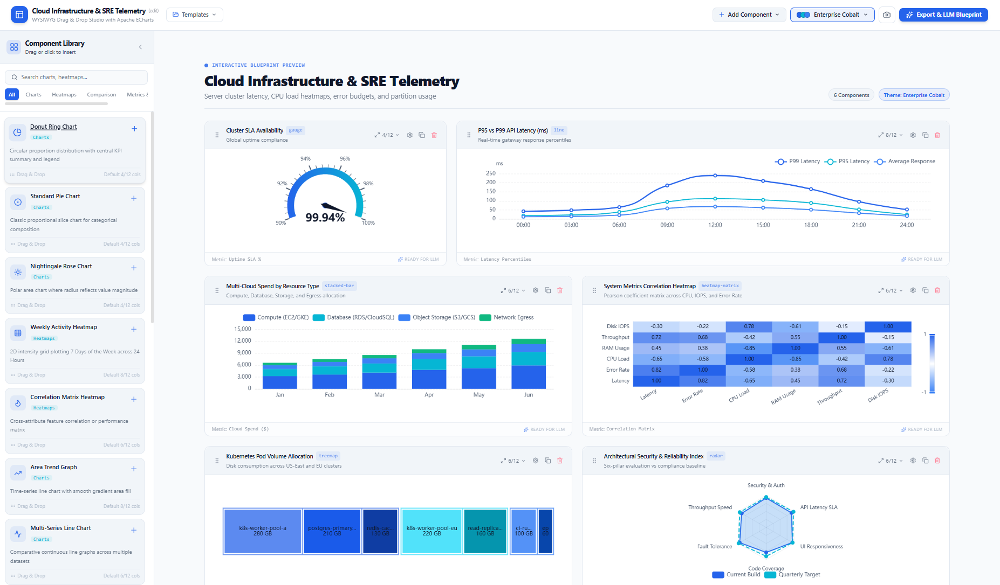
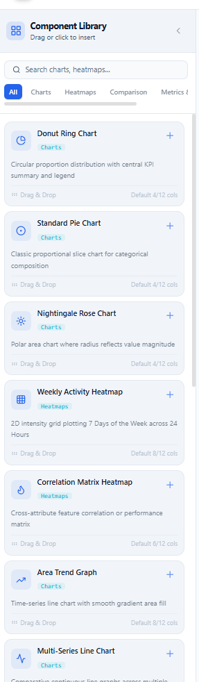
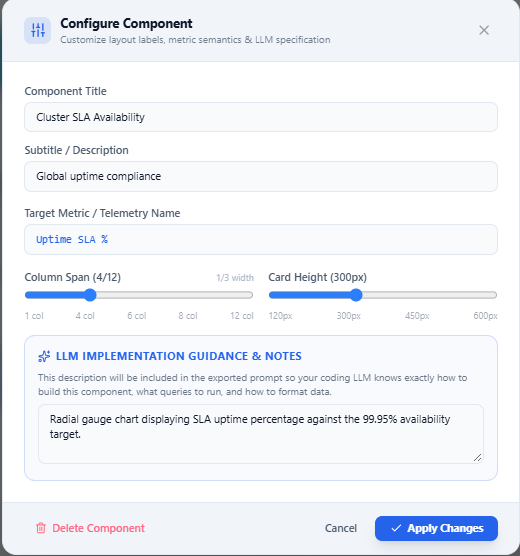
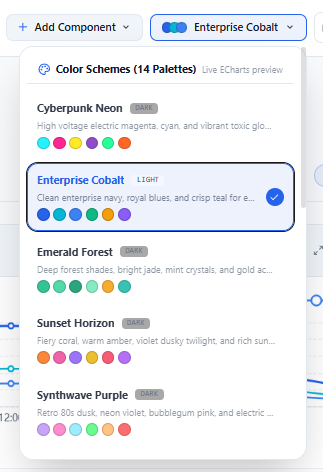
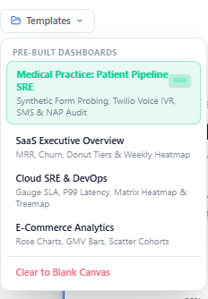
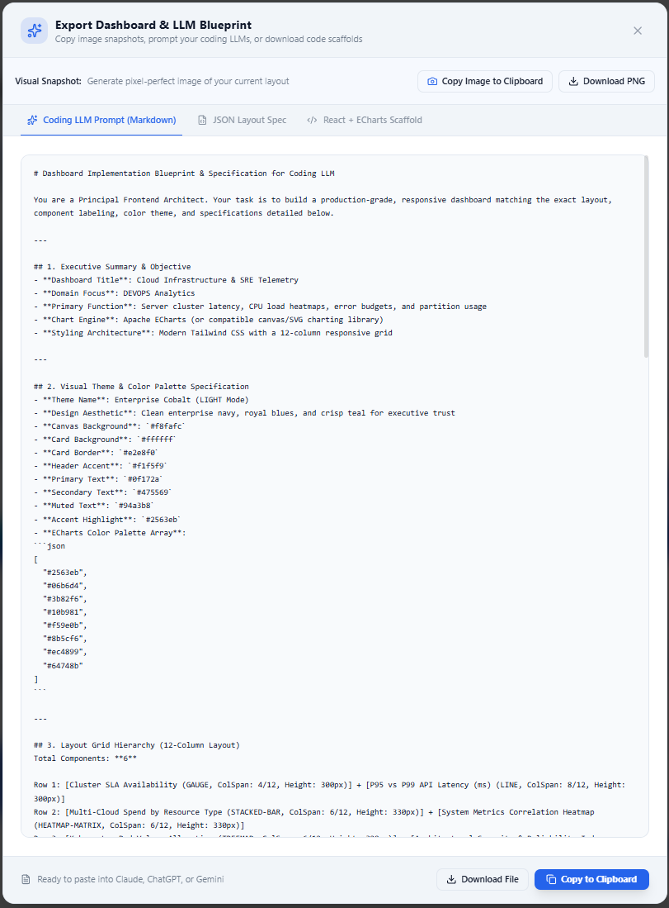
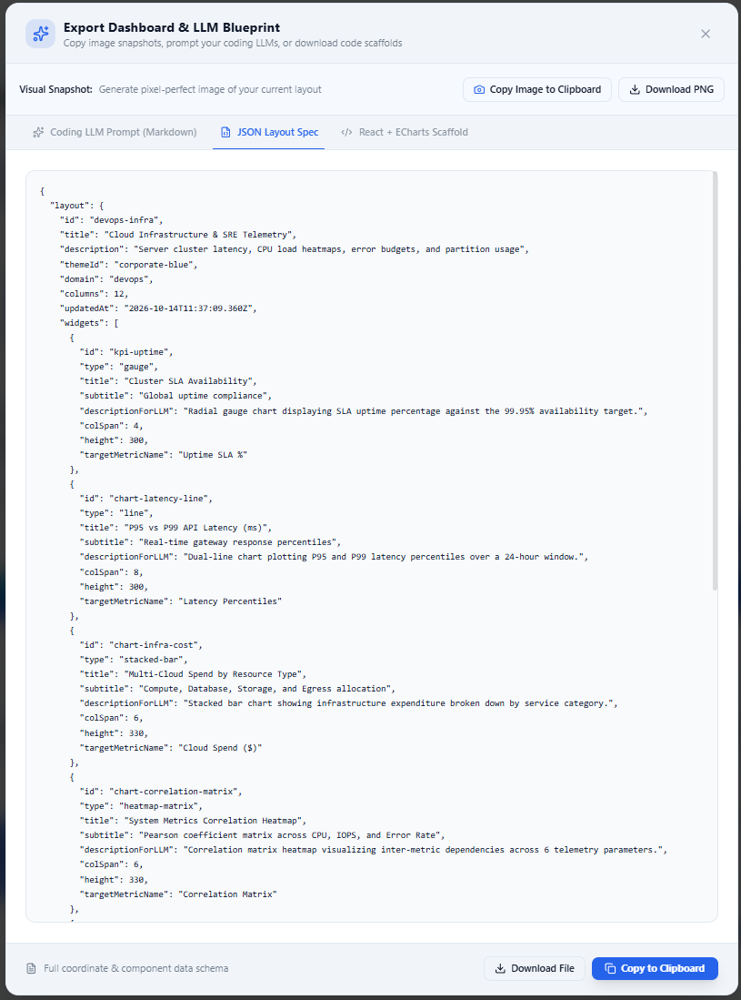

# drag-me-to-chart

> *“Cursed to assemble dashboards with your mouse forever.”*

**drag-me-to-chart** is a visual workbench designed for operations and engineering friends who "vibe code" with AI. It lets you visually compose, style, and structure dashboard concepts, then immediately export them into high-context prompts and blueprint specs for coding LLMs (Claude, ChatGPT, Gemini, Cursor).

> [!IMPORTANT]
> **What this is (and isn't):**
> This tool is **not** a live BI platform with database connections or real-time streaming backend pipelines. It's a visual-to-prompt scratchpad. It focuses on **chart types, visual themes, metric semantics, and prompt handoff**—giving your coding LLM the exact visual blueprint it needs to write production code without hallucinating layout details or chart choices.

---

## 💡 Why This Exists

> *"I was getting frustrated, as someone who likes to draw more than write, that it was hard to get my LLMs to produce dashboards the way I envisioned. Sure, taking a picture from the whiteboard works sometimes, but it just didn't seem structured enough, especially if I'm doing the same kind of dashboard over and over again.*
>
> *Hope it helps any of my operations vibe coding friends."*

When you ask an AI coding assistant to *"build me an operations dashboard"*, you typically get generic bar charts, mismatched cards, and arbitrary CSS colors. 

**drag-me-to-chart** bridges the gap between what you envision and what your LLM builds:
- **Choose the exact chart types** — Pick from radial gauges, activity heatmaps, multi-series trends, correlation matrices, treemaps, and radar charts instead of hoping the LLM guesses right.
- **Lock in visual themes & palettes** — Select from 14 curated color schemes so your generated frontend has consistent, executive-ready styling.
- **Annotate telemetry & LLM guidance** — Attach notes to each component specifying telemetry names, data formatting, and queries for the AI.
- **1-Click LLM Export** — Copy a structured markdown blueprint or JSON coordinate spec directly into your favorite coding assistant.



---

## ✨ Features & Walkthrough

### 1. 📊 Specialized Chart Types & Component Library
Select the right visualization for your operational metrics on a 12-column responsive grid. Includes **Cluster SLA Gauges**, **Multi-Series Latency Lines**, **Resource Stacked Bars**, **Weekly Activity Heatmaps**, **Correlation Matrices**, **Kubernetes Pod Treemaps**, and **Radar Indices**.

| Component Catalog | Component Inspector |
| :---: | :---: |
|  |  |
| *Filter by Charts, Heatmaps, Comparisons, and KPIs* | *Tune column spans, heights, metric names, & LLM prompts* |

---

### 2. 🎨 Themes & Pre-Built Templates
Set the mood and branding with live theme palettes or jumpstart your layout with pre-built operational templates.

| Curated Color Schemes | Pre-Built Dashboard Templates |
| :---: | :---: |
|  |  |
| *14 palettes (Cyberpunk, Cobalt, Emerald, Synthwave, etc.)* | *Starter templates: Cloud SRE, SaaS, Healthcare, E-Commerce* |

---

### 3. 🤖 LLM Blueprint & Multi-Format Export
Convert your visual dashboard directly into actionable specifications or copy a pixel-perfect snapshot with one click.

| Coding LLM Prompt Export | JSON Layout Specification |
| :---: | :---: |
|  |  |
| *Structured markdown prompt ready for Claude, ChatGPT, or Gemini* | *Full coordinate, widget type, and metric schema* |

- 🤖 **LLM Blueprint Generator:** Generates comprehensive frontend architect instructions so coding agents know exactly how to implement the backend queries, data models, and layout.
- 📐 **JSON Layout Spec:** Complete serializable layout tree for storage, sharing, or programmatic rendering.
- 📸 **1-Click Snapshot:** Copy high-res dashboard images directly to your clipboard or download as PNG.

---

## 🚀 Getting Started

### Prerequisites

- [Node.js](https://nodejs.org/) (v18+ recommended)
- `npm`

### Installation

```bash
# Clone the repository
git clone https://github.com/MuseBj/drag-me-to-chart.git

# Navigate into the project directory
cd drag-me-to-chart

# Install dependencies
npm install
```

### Development

Run the Vite development server:

```bash
npm run dev
```

Open [http://localhost:5173](http://localhost:5173) in your browser.

### Build

Create an optimized production build:

```bash
npm run build
```

To preview the production build locally:

```bash
npm run preview
```

### Linting

Run Oxlint:

```bash
npm run lint
```

---

## 🛠️ Tech Stack

- **Framework:** [React 19](https://react.dev/) + [TypeScript](https://www.typescriptlang.org/)
- **Build Tool:** [Vite 8](https://vitejs.dev/)
- **Styling:** [Tailwind CSS v4](https://tailwindcss.com/)
- **Charts:** [Apache ECharts](https://echarts.apache.org/)
- **Icons:** [Lucide React](https://lucide.dev/)
- **Exporting & Effects:** `html-to-image`, `canvas-confetti`
